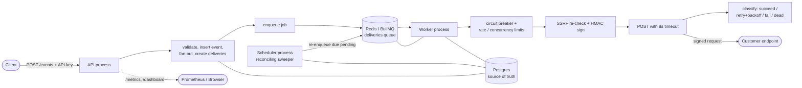
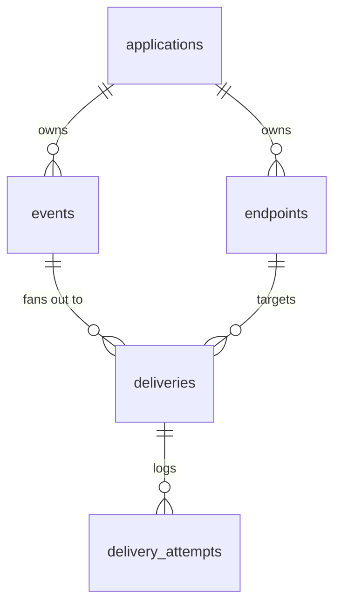

# Webhook Delivery Service

A service that reliably delivers webhooks to customer-supplied URLs. It **retries
intelligently, never loses events, never delivers duplicates, and lets receivers
verify authenticity** — the core problems every real webhook system has to solve.


---

## What it does

Customers register an application, add one or more **endpoints** (destination
URLs), and **publish events**. The service fans each event out to every
subscribed endpoint and delivers it over HTTP, guaranteeing:

- **At-least-once delivery** — an event is delivered at least once; duplicates are
  prevented by a database constraint and a stable event-id header receivers can
  dedupe on.
- **Intelligent retries** — only transient failures (5xx, timeouts, network
  errors, 429/408) are retried, with exponential backoff + jitter; permanent 4xx
  are not retried.
- **No silent loss** — failed deliveries exhaust their retries into a
  **dead-letter queue** you can inspect and **replay**. Postgres is the source of
  truth, so the work queue is fully rebuildable from it.
- **Authenticity** — every request is signed with HMAC-SHA256 over the timestamp
  and body, with replay protection; receivers verify with a shared secret.
- **Safety** — customer URLs are validated against SSRF (private/loopback/metadata
  ranges blocked), API keys are stored hashed, and secrets are never logged.

## Key features

- HMAC-SHA256 request signing + replay protection (`X-Webhook-Id/Timestamp/Signature`)
- Exponential backoff with full jitter; configurable max attempts
- Per-endpoint **circuit breaker** (closed → open → half-open)
- Per-endpoint **rate limiting** and **concurrency caps**
- **Dead-letter queue** + replay endpoint and dashboard button
- **Reconciling sweeper** that closes the "DB written but enqueue failed" gap and
  rebuilds the queue after Redis loss
- Idempotency keys (scoped per application)
- SSRF protection, hashed API keys, graceful shutdown
- Observability: Prometheus `/metrics`, a delivery status API, and a minimal dashboard
- Tested against **real Postgres + Redis** (not mocks), with CI and a chaos script

## Architecture

Three processes share Postgres and Redis. **Postgres is the source of truth;
Redis/BullMQ only holds the work queue, which is recoverable from Postgres.**



- **API** (`src/index.ts`, `src/routes/`) — authenticates, validates, stores the
  event, fans out to subscribed endpoints, enqueues jobs. Also serves `/health`,
  `/metrics`, the status API, and the dashboard.
- **Worker** (`src/worker/`) — consumes jobs, signs and POSTs with a hard timeout,
  records every attempt, applies the circuit breaker / limits, and drives the
  retry → dead-letter lifecycle.
- **Scheduler** (`src/scheduler/`) — a single instance that periodically
  re-enqueues due `pending` deliveries (the reliability backstop).

**Delivery lifecycle:** `pending` → (`succeeded` | `failed` (permanent 4xx) |
`dead` (retries exhausted)). A `dead` delivery can be replayed back to `pending`.

## Tech stack

TypeScript · Node.js 22 · Express · PostgreSQL 17 · Redis 7 · BullMQ · pino · zod
· prom-client · Docker Compose · Vitest + Supertest · GitHub Actions · autocannon.

## Data model



- **applications** — tenant; stores the **hashed** API key.
- **endpoints** — destination URL, HMAC secret, subscribed `event_types`, optional
  rate-limit / concurrency overrides, status.
- **events** — type + JSON payload + optional idempotency key, **UNIQUE
  (application_id, idempotency_key)**.
- **deliveries** — one per (event × endpoint) with **UNIQUE (event_id,
  endpoint_id)**; tracks status, attempts, and `next_attempt_at`.
- **delivery_attempts** — append-only log of each POST (status code, latency,
  error, response snippet).

Full schema and the reasoning behind every constraint/index are in
[`migrations/`](migrations/) and [`docs/decisions.md`](docs/decisions.md).

## Project structure

```
proj1/
├── docker-compose.yml        # api, worker, scheduler, chaos-receiver, postgres, redis
├── Dockerfile                # multi-stage: dev (tsx watch) and prod (compiled)
├── migrations/               # node-pg-migrate SQL migrations
├── src/
│   ├── index.ts              # API server bootstrap + graceful shutdown
│   ├── app.ts                # Express app: routers + middleware + error handler
│   ├── config/env.ts         # zod-validated, fail-fast environment config
│   ├── lib/
│   │   ├── db.ts             # shared pg Pool (+ error handling)
│   │   ├── redis.ts          # shared ioredis client
│   │   ├── queue.ts          # BullMQ producer (enqueueDelivery)
│   │   ├── logger.ts         # pino logger with secret redaction
│   │   ├── crypto.ts         # API key / secret generation + hashing
│   │   ├── signing.ts        # HMAC sign + verify (constant-time, replay window)
│   │   ├── ssrf.ts           # SSRF guard (private/loopback/metadata blocking)
│   │   └── metrics.ts        # prom-client registry (DB-derived gauges)
│   ├── middleware/           # apiKeyAuth, zod body validation
│   ├── routes/               # health, applications, endpoints, events,
│   │                         #   deliveries, metrics, dashboard
│   ├── worker/
│   │   ├── index.ts          # BullMQ worker bootstrap + graceful shutdown
│   │   ├── processor.ts      # the delivery logic (sign, POST, classify, retry)
│   │   ├── backoff.ts        # exponential backoff + full jitter
│   │   ├── classify.ts       # retryable vs permanent
│   │   ├── circuit-breaker.ts# per-endpoint breaker (Redis)
│   │   ├── limiter.ts        # per-endpoint rate limit + concurrency (Redis)
│   │   └── repository.ts     # delivery/attempt DB state transitions
│   ├── scheduler/            # reconciling sweeper loop
│   └── chaos-receiver/       # deliberately flaky receiver for testing/demos
├── tests/
│   ├── unit/                 # signing, classify, backoff, ssrf
│   ├── integration/          # publish (supertest) + delivery (real BullMQ worker)
│   └── helpers/              # test DB, receiver, worker, wait utilities
├── scripts/
│   ├── chaos-test.mjs        # end-to-end chaos test against the live stack
│   ├── load/                 # autocannon publish + delivery benchmarks
│   └── experiments/          # the failure experiments
├── docs/                     # decisions, architecture, benchmarks, demo, Q&A...
└── .github/workflows/ci.yml  # lint, typecheck, build, test (with PG + Redis)
```

## Getting started (run locally)

**Prerequisites:** [Docker Desktop](https://www.docker.com/products/docker-desktop/)
(running) and, for tests/scripts, Node.js 22+.

```bash
# 1. Copy the env template and set a Postgres password
cp .env.example .env
#    edit .env -> POSTGRES_PASSWORD=<your password>

# 2. Build and start everything (api, worker, scheduler, chaos-receiver, pg, redis)
docker compose up -d --build

# 3. Create the database schema
docker compose run --rm migrate

# 4. Verify
docker compose ps                     # all services Up; postgres/redis (healthy)
curl http://localhost:3000/health     # -> {"status":"ok", ...}
```

Stop with `docker compose down` (keeps data) or `docker compose down -v` (wipes
the database).

## Usage — try it

```bash
# Register an app (returns the API key ONCE — copy it)
curl -s -XPOST http://localhost:3000/applications \
  -H "content-type: application/json" -d '{"name":"demo"}'

KEY=whsk_...   # paste the api_key from above

# Create an endpoint subscribed to "demo.event" (points at the built-in flaky receiver)
curl -s -XPOST http://localhost:3000/endpoints \
  -H "authorization: Bearer $KEY" -H "content-type: application/json" \
  -d '{"url":"http://chaos-receiver:4000/hook","event_types":["demo.event"]}'

# Publish an event
curl -s -XPOST http://localhost:3000/events \
  -H "authorization: Bearer $KEY" -H "content-type: application/json" \
  -d '{"type":"demo.event","payload":{"orderId":1}}'
```

Then open the **dashboard** at <http://localhost:3000/dashboard>, paste your API
key, and watch deliveries retry and succeed. A full guided walkthrough (including
how to force failures and replays) is in [`docs/demo.md`](docs/demo.md).

## API reference

| Method | Path | Auth | Purpose |
|---|---|---|---|
| POST | `/applications` | none | Register an app; returns the API key once |
| GET | `/applications/me` | API key | Current application (auth check) |
| POST | `/endpoints` | API key | Create an endpoint (url, event_types, optional throttles) |
| POST | `/events` | API key | Publish an event (type, payload, optional idempotency_key) |
| GET | `/deliveries` | API key | List deliveries (filter `?status=`) |
| GET | `/deliveries/:id` | API key | One delivery + its full attempt history |
| POST | `/deliveries/:id/replay` | API key | Re-queue a dead/failed delivery |
| GET | `/health` | none | Liveness (Postgres + Redis) |
| GET | `/metrics` | none | Prometheus metrics |
| GET | `/dashboard` | none* | Minimal UI (*enter an API key in the page) |

Auth is `Authorization: Bearer <api_key>`.

## Configuration

All configuration is environment variables, validated at startup
([`src/config/env.ts`](src/config/env.ts)); the app fails fast if any is invalid.
Inside Docker Compose these are set for you; defaults shown below.

| Variable | Default | Meaning |
|---|---|---|
| `PORT` | `3000` | API port |
| `LOG_LEVEL` | `info` | pino log level |
| `DATABASE_URL` | — | Postgres connection string |
| `REDIS_URL` | — | Redis connection string |
| `DELIVERY_TIMEOUT_MS` | `8000` | Hard timeout per outbound POST |
| `MAX_ATTEMPTS` | `6` | Attempts before a delivery is `dead` |
| `BACKOFF_BASE_MS` / `BACKOFF_CAP_MS` | `1000` / `300000` | Backoff base and cap |
| `WORKER_CONCURRENCY` | `10` | Jobs processed concurrently per worker |
| `SIGNATURE_TOLERANCE_SEC` | `300` | Replay window for signature verification |
| `ENDPOINT_RATE_LIMIT_PER_SEC` | `100` | Default per-endpoint send rate |
| `ENDPOINT_MAX_CONCURRENCY` | `20` | Default per-endpoint in-flight cap |
| `CB_FAILURE_THRESHOLD` / `CB_OPEN_MS` / `CB_HALF_OPEN_MAX` | `5` / `30000` / `1` | Circuit breaker tuning |
| `SWEEP_INTERVAL_MS` / `SWEEP_BATCH` | `10000` / `100` | Sweeper cadence and batch size |
| `SSRF_ALLOW_PRIVATE` | `false` | Dev-only: allow private IPs (so the in-cluster chaos receiver is reachable) |

## Testing

```bash
npm install          # install dependencies (for host-run tests/scripts)
npm test             # 32 unit + integration tests (needs the stack up for PG/Redis)
npm run lint         # eslint
npx tsc --noEmit     # typecheck
npm run build        # compile to dist/
```

- **Unit tests** cover signing, retry classification, backoff bounds, and SSRF.
- **Integration tests** run against **real Postgres and Redis** (an isolated test
  database + Redis index), driving a **real in-process BullMQ worker** against a
  controllable receiver — covering success, retry→success, permanent-4xx,
  timeout, exhaustion→DLQ, and replay.
- **Chaos test** (`npm run chaos:test`) exercises the full running stack:
  retry→success, DLQ, replay, 100× idempotency, and tampered-body rejection.
- **CI** ([`.github/workflows/ci.yml`](.github/workflows/ci.yml)) runs lint →
  typecheck → build → tests with Postgres and Redis service containers.

## Benchmarks & failure experiments

Load tests ([`npm run bench:publish`](scripts/load/publish-bench.mjs),
[`bench:delivery`](scripts/load/delivery-bench.mjs)) and six failure experiments
([`npm run experiments`](scripts/experiments/run.mjs)) are reproducible, and raw
output is committed.

> **Honesty note:** all numbers are measured on a single developer laptop with the
> whole stack **and** the load generator on one machine, and the receiver is an
> in-container server on localhost — a dev-box ceiling, not a production figure.

Indicative measured results (see [`docs/BENCHMARKS.md`](docs/BENCHMARKS.md) and
[`docs/EXPERIMENTS.md`](docs/EXPERIMENTS.md) for full context and raw files):
~300+ publish requests/sec with a ~0.1–0.15s p99; worker-kill recovery in tens of
seconds with no loss; simulated Redis data loss recovered in ~1–2s via the
sweeper; persistent failure → DLQ → replay.

## Design decisions & trade-offs

Highlights (full log in [`docs/decisions.md`](docs/decisions.md)):

- **At-least-once, not exactly-once** — impossible to guarantee exactly-once across
  a network; prevent duplicates with `UNIQUE(event_id, endpoint_id)`, queue-level
  dedupe, and a receiver-side `X-Webhook-Id`. Receivers must be idempotent.
- **Postgres is the source of truth; Redis is disposable** — the sweeper rebuilds
  the queue from Postgres, so Redis loss costs no data.
- **BullMQ-native retries with full jitter** — reuse battle-tested scheduling;
  jitter prevents a thundering herd when a receiver recovers.
- **Reconciling sweeper over a transactional outbox** — simpler, and it doubles as
  Redis recovery; the trade-off is a lost enqueue self-heals within one sweep
  interval rather than instantly.
- **SHA-256 for API keys, HMAC for requests, SSRF checks at creation and delivery**
  — fast exact-match for high-entropy keys; DNS-rebinding defended by re-checking
  before each POST.

## Documentation

- [`docs/architecture.md`](docs/architecture.md) — diagram + trade-offs digest
- [`docs/decisions.md`](docs/decisions.md) — full design-decision log
- [`docs/BENCHMARKS.md`](docs/BENCHMARKS.md) / [`docs/EXPERIMENTS.md`](docs/EXPERIMENTS.md) — measured results
- [`docs/demo.md`](docs/demo.md) — step-by-step local demo runbook
- [`docs/interview-questions.md`](docs/interview-questions.md) — 50 Q&A covering the system in depth

## Roadmap

Production deployment (a VPS with Nginx + HTTPS, or a container PaaS) is the
deferred next step; the service is otherwise feature-complete for its scope.
Out of scope: billing, a signup UI, and multi-region deployment.
